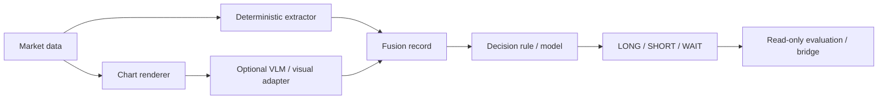
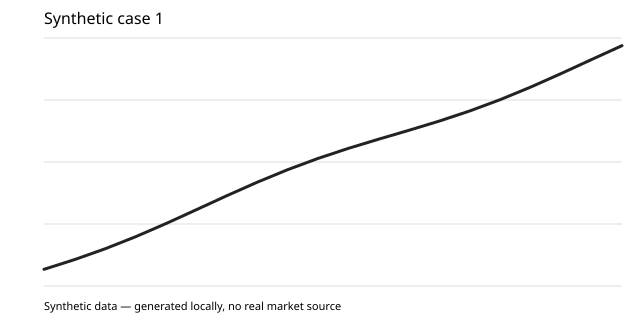
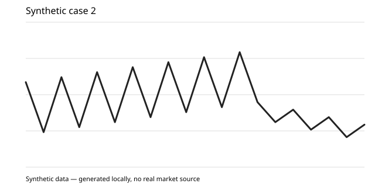
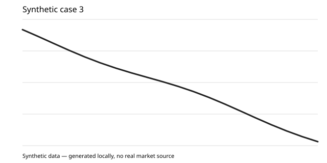

# Multimodal Market AI

**A causal research framework for financial-market systems that combine deterministic rules, numerical models and visual/VLM information.**

[](LICENSE)
[](https://www.python.org/)
[](#project-status)

> **Not a money-printing bot. Not a signal-selling service. Not a promise of profit.**
>
> This is an open research and engineering framework for building, auditing and comparing
> multimodal market-analysis systems while keeping private strategy logic private.

## Understand the project in 10 seconds



The visual path is optional. A VLM is not automatically better than a deterministic or numerical
baseline: it must prove that it adds useful information.

The operational pipeline stays simple:

```text
ACQUIRE -> EXTRACT -> DECIDE -> APPLY
```

Training, model arenas, caches, visual models and audits support those four jobs. They are not
separate mandatory pipelines.

## Try the complete CPU-only demo

No broker account, market-data download, GPU or large model is required.

```bash
git clone https://github.com/bobbonauta/Multimodal-Market-AI.git
cd Multimodal-Market-AI
python -m venv .venv
```

Linux/macOS:

```bash
source .venv/bin/activate
pip install -e ".[dev]"
python examples/synthetic_multimodal/run_demo.py
```

Windows PowerShell:

```powershell
.\.venv\Scripts\Activate.ps1
pip install -e ".[dev]"
python examples\synthetic_multimodal\run_demo.py
```

The demo creates synthetic OHLCV data, three chart images, deterministic features, a mock visual
feature and a final fusion table:

```text
synthetic market data
        |
        +------> deterministic signals -----+
        |                                   |
        +------> chart image -> mock visual-+
                                            |
                                            v
                                       fusion table
                                            |
                                            v
                                    LONG / WAIT / SHORT
```

Expected teaching cases:

| Case | Deterministic result | Mock visual result | Final decision |
|---|---:|---:|---|
| `case_001` | +1 | +1 | `LONG` |
| `case_002` | -1 | 0 | `WAIT` |
| `case_003` | -1 | -1 | `SHORT` |

The mock visual adapter is deliberately simple and deterministic. It demonstrates the wiring
between an image path, a visual feature and the fusion record. Replace it with Qwen, Gemma,
InternVL or another VLM only when you are ready to test a real visual model.

### Three synthetic charts included in the repository

| Up-trending teaching case | Mixed teaching case | Down-trending teaching case |
|---|---|---|
|  |  |  |

All three images are generated from fake data. They do not contain a private strategy or real
market sample.

Read the walkthrough: [Synthetic multimodal demo](examples/synthetic_multimodal/README.md).

## What is a fusion table?

It is simply one row per decision/event containing information that was available at that time.

For example:

```text
case_id  | trend | momentum | structure | visual | deterministic | decision
case_001 | +1    | +1       | +1        | +1     | +1            | LONG
case_002 |  0    |  0       | -1        |  0     | -1            | WAIT
case_003 | -1    | -1       | -1        | -1     | -1            | SHORT
```

Your own project can replace every example column. The important part is the contract:

- each row has a stable identity and decision time;
- inputs must already exist at decision time;
- unavailable data is not invented;
- future outcomes are labels/evaluation data, not model inputs;
- deterministic, numerical and visual sources stay separable enough to audit.

## Two ways to use the framework

### I already have a bot or EA

Keep it.

```text
existing bot
    |
    v
small adapter / bridge
    |
    +--> causal market context
    +--> optional numerical features
    +--> optional visual/VLM features
    |
    v
fusion / evaluation / read-only result
```

The bridge should transport information. It should not secretly rebuild a second copy of the
private strategy.

Start here: [Integrating an existing bot or EA](docs/INTEGRATING_EXISTING_BOTS.md).

### I do not have a bot yet

Build a simple deterministic baseline first.

```text
market data
    |
simple replaceable rules
    |
deterministic result
    |
optional numerical / visual information
    |
fair comparison
```

Read: [Multi-signal and deterministic model](docs/MULTI_SIGNAL_AND_DETERMINISTIC_MODEL.md).

## Deterministic first, AI later

A complex model needs something reproducible to beat.

```text
build the deterministic/data path
        |
        v
prove causality + reproducibility
        |
        v
freeze it
        |
        v
compare candidate models fairly
        |
        v
keep AI only if it adds value
```

The public freeze protocol includes:

- future-appended data must not rewrite old canonical records;
- isolated runs should match sequential runs;
- inputs must be fingerprinted before outputs are compared;
- schema/dtype differences must be separated from real value differences;
- unavailable fields must not be invented;
- the frozen core must stay unchanged during final model comparison.

Read: [Deterministic freeze protocol](docs/DETERMINISTIC_FREEZE_PROTOCOL.md).

## Real multimodal research results

The repository publishes aggregate metrics from a completed internal model arena while keeping
strategy rules, private features, datasets and adapter weights closed.

| Model | Adapted holdout macro-F1 |
|---|---:|
| Qwen3-VL 8B | **0.8764** |
| Gemma 4 12B | **0.7886** |
| Qwen3-VL 4B | **0.7485** |
| Qwen2.5-VL 7B | **0.7454** |
| Gemma 4 26B-A4B | **0.6502** |
| InternVL 3.5 14B | **0.4971** |
| MiniCPM-V 4.6 | 0.2078 |
| Liquid 3B | 0.1911 |

Important lessons from that arena:

- bigger was not automatically better;
- one aggregate metric can hide a failed subtask;
- some adapters improved strongly while others made a model worse;
- GPU hourly price is not the same as total experiment cost;
- a smoke test is useful for feasibility but may predict full-run speed poorly;
- negative results are worth publishing because they prevent repeated waste.

Full methodology, base scores, subtasks, GPU time and cost:
[Multimodal model arena — public results](docs/MODEL_ARENA_RESULTS.md).

These are research metrics, **not trading-performance claims**.

## Decision semantics

The public deterministic helper uses:

- `+1` = a rule points one way;
- `-1` = a rule points the other way;
- `0` = that individual rule is not voting.

A final application can map the combined result to:

```text
LONG
SHORT
WAIT
```

`WAIT`, rule-level `0`, missing data and a longer-lived internal state are different concepts.
Do not collapse them into one variable.

## Causality in one example

```text
Decision time: 10:07
Bar closed at: 10:05  -> allowed
Bar closed at: 10:10  -> not allowed yet
```

If an input did not exist at the decision time, it cannot be used.

## Hugging Face

The repository now includes an export package for Hugging Face:

```text
huggingface/
    dataset/        synthetic-demo dataset card
    space/          CPU demo Space
    export_to_hub.py
```

GitHub remains the canonical source. Hugging Face is an export/discovery surface, not a second
independent codebase.

With a Hugging Face token that has **write** permission:

```bash
pip install -e ".[hf]"
python huggingface/export_to_hub.py --dry-run
python huggingface/export_to_hub.py
```

Read: [Hugging Face export](docs/HUGGING_FACE.md).

## Existing smaller examples

Deterministic combiner:

```bash
python examples/deterministic_multi_signal.py
```

Existing-bot integration:

```bash
python examples/existing_bot_integration.py
```

Run the full tests:

```bash
pytest
```

## Main rules

- **One operational pipeline** — acquire, extract, decide, apply.
- **Open workflow, closed strategy** — publish reusable engineering, not proprietary rules.
- **Do not look into the future** — every input must exist at decision time.
- **Freeze before final comparison** — stabilize data and deterministic logic first.
- **Compare models fairly** — same rows, split, target and metrics.
- **Simple before expensive** — baseline first, GPU later.
- **Fail closed** — missing required information is not silently invented.
- **Bridge, do not duplicate** — external integration transports the frozen result.
- **AI must earn its place** — complexity is optional, evidence is required.

## Project status

**Early alpha.** The repository already includes causal helpers, deterministic combination,
integration primitives, provenance/sealing utilities, a CPU-only multimodal demo, published model
arena results and a Hugging Face export layout.

Full MT4/MT5 public bridging, broader public datasets, production model adapters and forward
journals remain ongoing work.

## Documentation

Start here:

1. [Synthetic multimodal demo](examples/synthetic_multimodal/README.md)
2. [Operational pipeline](docs/OPERATIONAL_PIPELINE.md)
3. [Multi-signal and deterministic model](docs/MULTI_SIGNAL_AND_DETERMINISTIC_MODEL.md)
4. [Deterministic freeze protocol](docs/DETERMINISTIC_FREEZE_PROTOCOL.md)
5. [Integrating an existing bot or EA](docs/INTEGRATING_EXISTING_BOTS.md)
6. [Multimodal model arena results](docs/MODEL_ARENA_RESULTS.md)
7. [Hugging Face export](docs/HUGGING_FACE.md)
8. [Lessons learned](docs/LESSONS_LEARNED.md)

More technical material:

- [Architecture](docs/ARCHITECTURE.md)
- [Project status](docs/PROJECT_STATUS.md)
- [Public research workflow](docs/PUBLIC_WORKFLOW_SYNC.md)
- [Model adapters](docs/MODEL_ADAPTERS.md)
- [Fine-tuning guide](docs/FINETUNING_GUIDE.md)
- [Benchmarking](docs/BENCHMARKING.md)
- [Roadmap](docs/ROADMAP.md)
- [Repository governance](docs/REPOSITORY_GOVERNANCE.md)
- [Contributing](CONTRIBUTING.md)

## Disclaimer

This software is for research and education. Financial markets involve risk. Nothing in this
repository is investment advice or a guarantee of future results.

## License

Code in this repository is licensed under the Apache License 2.0. Datasets, model weights and
third-party models may have separate licenses.
